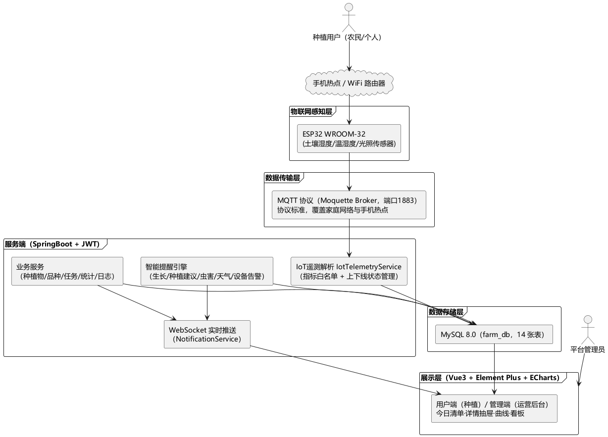
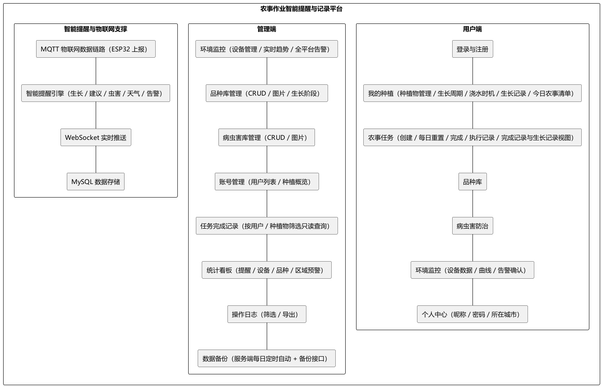
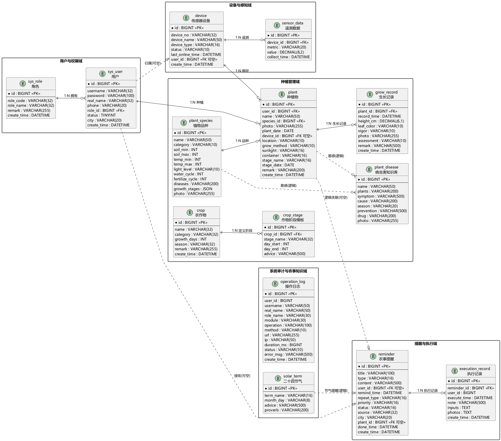
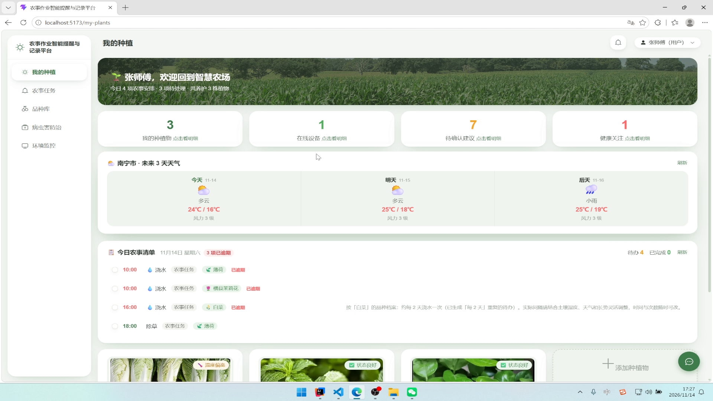
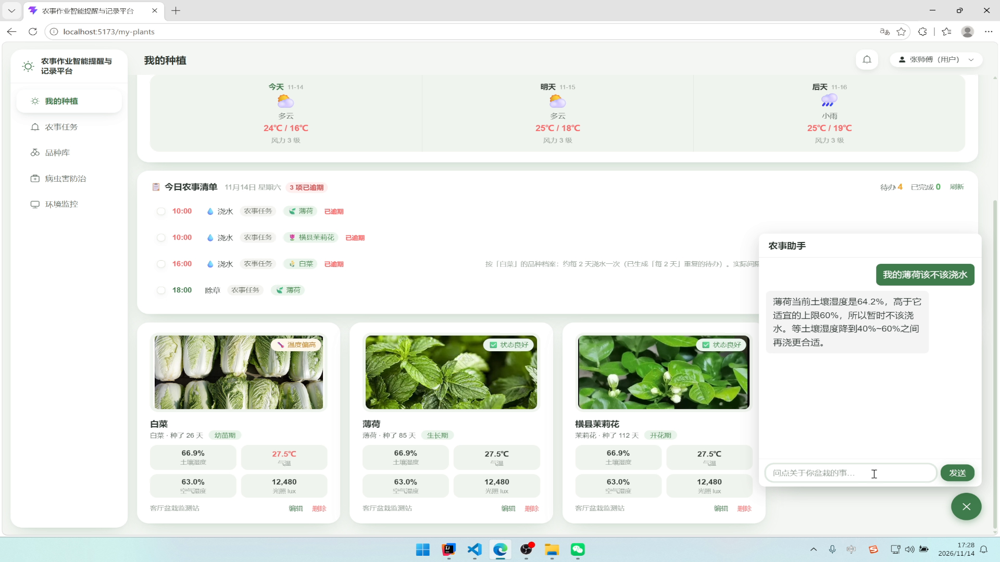
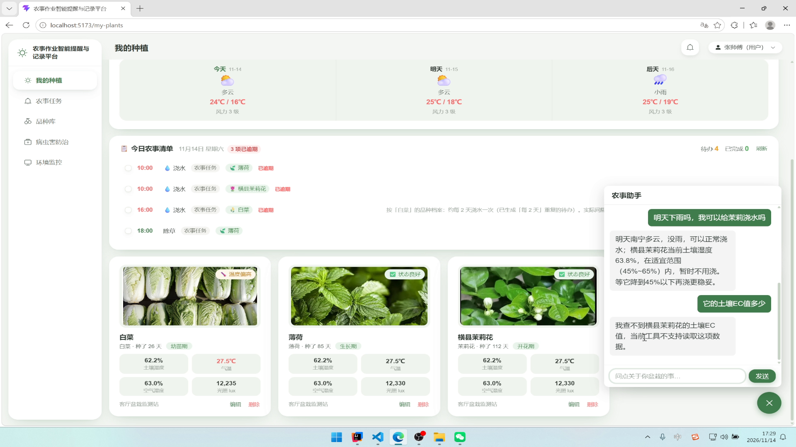
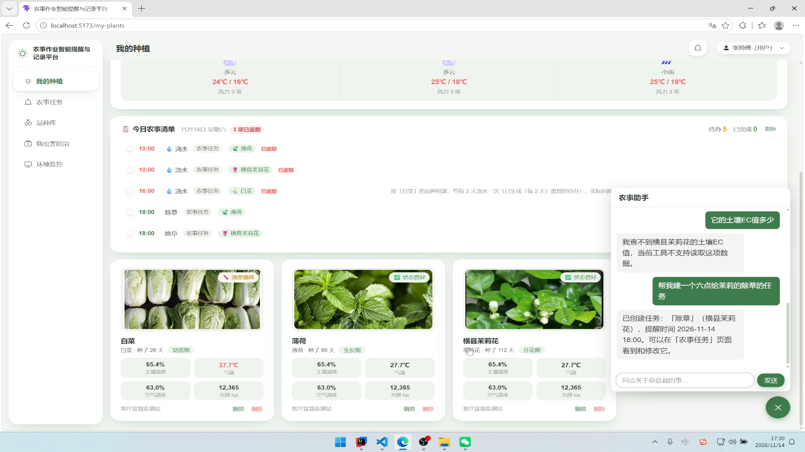

# 农事作业智能提醒与记录平台

面向家庭种植与小型农场的「物联网 + AI」管理平台。一块 ESP32 监测站按 5 秒的节奏采集环境数据，后端落库并按品种阈值给出养护建议；用户端与管理端各一套页面，内置一个能查实时读数、查品种资料、查病虫害、查天气、检索知识库、建提醒任务的 AI 农事助手。

    

## 技术栈

| 层 | 选型 |
|---|---|
| 后端 | Java 17 · Spring Boot 3.5 · MyBatis-Plus · Spring AI · JWT |
| 用户端 | Vue 3 · TypeScript · Vite · Vant |
| 管理端 | Vue 3 · TypeScript · Element Plus · ECharts |
| 数据库 | MySQL 8（14 张表） |
| 消息 | MQTT（Moquette 内嵌 Broker + Paho） |
| 实时推送 | WebSocket |
| 缓存 | Redis |
| 感知端 | ESP32 · DHT11 · 土壤湿度 · 光敏电阻 |
| 大模型 | 通义千问 qwen-plus + text-embedding-v4 |

## 核心功能

- **环境监测**：设备每 5 秒上报温湿度、土壤湿度、光照、信号强度，前端 SSE 实时刷新曲线
- **智能提醒**：按品种的浇水/施肥周期生成农事任务，定时扫描、逾期标记、完成闭环
- **品种库**：188 个作物品种的生长阶段、适宜区间、养护要点（附品种图）
- **病虫害库**：158 条病虫害的易感品种、症状、防治方法与用药
- **AI 农事助手**：见下节
- **双端分离**：用户端（Vant）与管理端（Element Plus）各有独立路由与权限

## AI 农事助手

不是「给页面接一个对话框」，而是一条完整的工具调用链路。

**6 个工具**，由模型自主决定调哪一个、传什么参数：

| 工具 | 作用 |
|---|---|
| 实时读数查询 | 取该植物绑定设备的最新一轮遥测，并附品种适宜区间做越界判断 |
| 品种资料查询 | 生长阶段、浇水/施肥周期、光照需求、养护要点 |
| 易感病虫害查询 | 按品种索引的病虫害名单（只给名单，不给防治方法，避免越界） |
| 三天天气预报 | 南宁/柳州/桂林三城，供浇水判断使用 |
| 知识库检索 | 158 条病虫害 + 24 节气农事，向量检索 |
| 建提醒任务 | 把用户口述的时间与事项落成农事任务 |

**三道工程约束**

1. **防编造护栏**：回答里出现的每个数值，都要在当前上下文里找到出处（工具返回或用户原话）；找不到就整段替换成「这个我查不到」。宁可说不会，也不许编。
2. **三级降级**：模型超时 → 预置答案并提示不可用；检索失败 → 只答有依据的部分并说明；整体不可用 → 页面其他功能照常。
3. **上下文裁剪**：会话只保留最近 20 条；工具返回只投喂摘要字段，避免上下文被撑爆。

**实测**：口语化提问「叶子发黄怎么办」在关键词检索里 0 命中，向量检索 top-1 余弦相似度 0.73。

## 系统架构





## 数据库设计

14 张表，按用户权限、设备感知、种植管理、提醒执行、系统审计与知识五个域划分。



## 页面截图

**用户端 · 我的种植**（天气、任务清单、每种植物的实时读数与状态）



**AI 助手 · 多工具判断**



> 问「该不该浇水」→ 查实时读数（土壤湿度 64.2%）+ 品种适宜区间（上限 60%）→ 判断暂时不该浇。

**AI 助手 · 查不到就说查不到**



> 问「土壤 EC 值多少」→ 系统里没有这个指标，它直接说查不到，不编数字。

**AI 助手 · 建提醒任务**



> 说「帮我建一个六点给茉莉的除草任务」→ 任务落库，左侧清单实时多出一条 18:00。

## 快速开始

```bash
# 1. 建库导表
mysql -uroot -p -e "CREATE DATABASE farm_db DEFAULT CHARSET utf8mb4;"
mysql -uroot -p farm_db < db/schema.sql

# 2. 后端（内嵌 MQTT Broker：8080 / 1883）
cd backend
mvn spring-boot:run

# 3. 用户端（5173）
cd frontend && npm install && npm run dev

# 4. 管理端（5174）
cd frontend-admin && npm install && npm run dev
```

或直接双击根目录的 `启动用户端.bat` / `启动管理端.bat`。

**需要配置的环境变量**

| 变量 | 说明 |
|---|---|
| `DB_PASSWORD` | MySQL 密码（默认 123456） |
| `AI_DASHSCOPE_API_KEY` | 通义千问 API Key，不配则 AI 助手降级 |
| `WEATHER_KEY` / `WEATHER_HOST` | 和风天气 Key 与域名，不配则天气工具不可用 |

ESP32 固件在 `firmware/`，烧录与接线说明见 `docs/ESP32固件烧录说明.md`、`docs/ESP32硬件接线教程.md`。

## 文档

| 文档 | 内容 |
|---|---|
| [接口文档](docs/接口文档.md) | 全部 REST 接口的入参、出参与示例 |
| [Agent 模块设计方案](docs/Agent模块设计方案.md) | 工具定义、提示词结构、护栏与降级的设计取舍 |
| [ESP32 固件烧录说明](docs/ESP32固件烧录说明.md) | 烧录步骤与常见问题 |

## 演示

[](https://github.com/Shouke-He/farm-platform/releases/download/v1.0-demo/farm-platform-demo.mp4)

3 分钟带解说与字幕，完整走一遍 AI 助手的六类问答：多工具判断、查不到就说查不到、建任务落库。

---

本项目由作者独立完成：需求梳理、数据库设计、后端接口、双端页面、ESP32 固件与部署上线，全流程一人推进。
